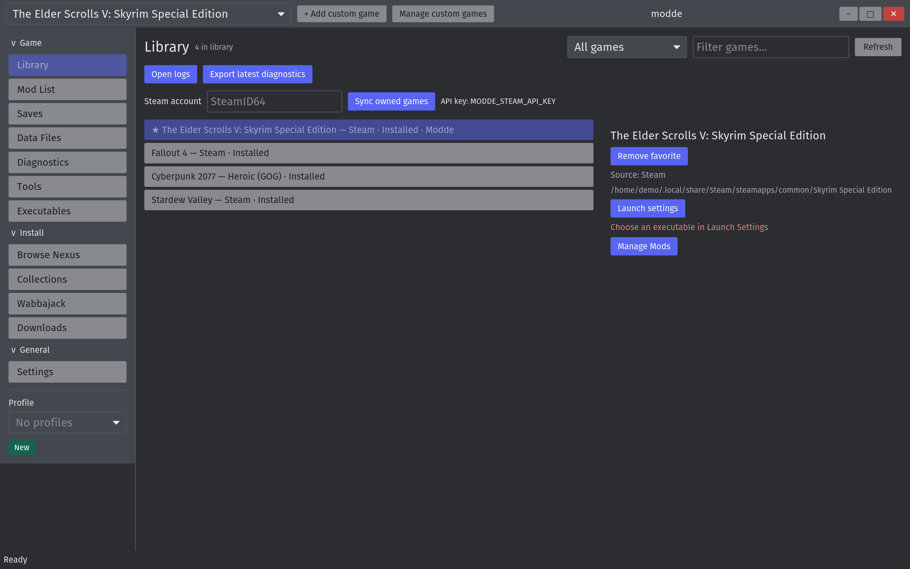
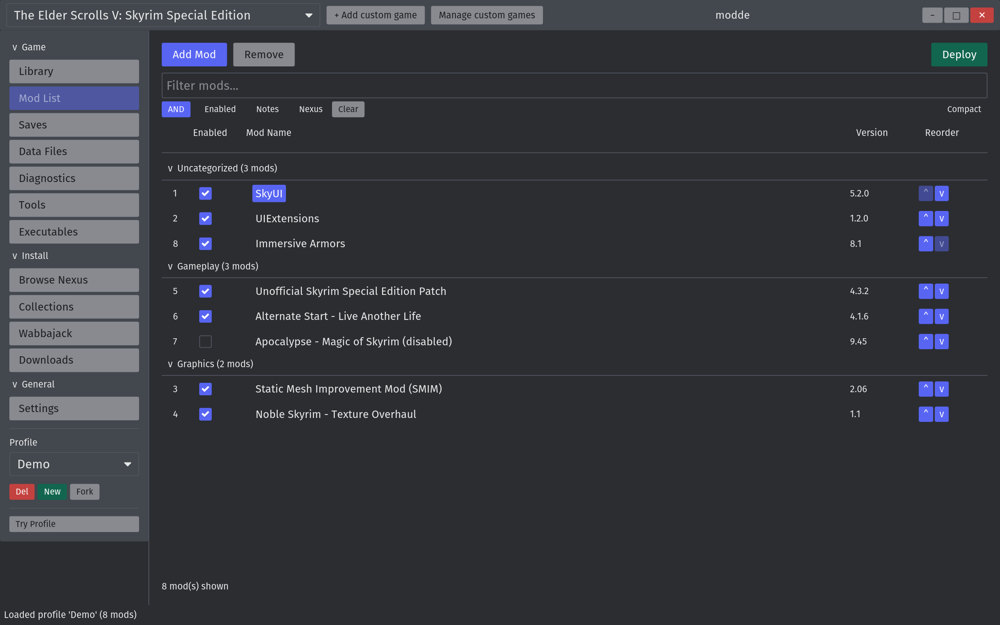
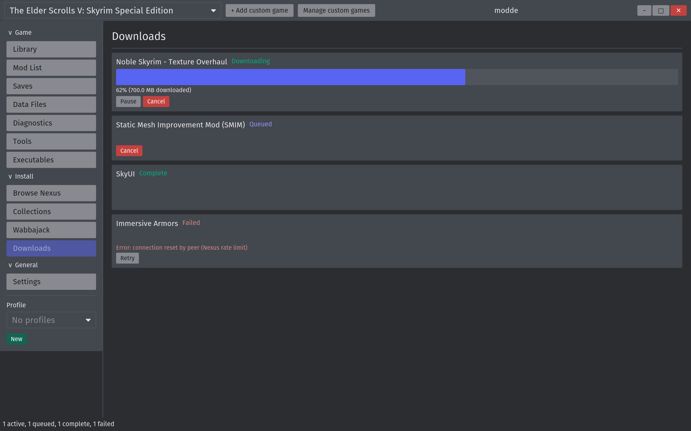

# Using the GUI

`modde-ui` is the desktop front end for the same engine the CLI drives. Launch
it from your application menu (packages install a desktop entry) or run
`modde-ui` or `modde gui` from a terminal.

## Layout

- **Title bar** — the game picker, custom-game management, and the window
  controls.
- **Sidebar** — three groups of screens, then the profile controls:
  - *Game*: Library, Mod List, Saves, Data Files, Diagnostics, Tools,
    Executables.
  - *Install*: Browse Nexus, Collections, Wabbajack, Downloads.
  - *General*: Settings.
- **Status line** — the outcome of the last action. Errors are shown in the
  theme's danger colour.

Hover any button for a moment to see what it does.

## Profiles

Below the navigation: pick the active profile, **New** creates one for the
selected game, **Fork** copies the active profile as `<name>-fork`, and **Del**
removes it after a confirmation. **Try Profile** starts an experiment layer on
top of the profile; **Rollback** (confirmed) discards it and **Commit** keeps
it.

## Mod List

Toggle mods with the checkbox, reorder with the arrows, and narrow the list
with the text filter or the Enabled / Notes / Nexus tri-state filters.
**Deploy** writes the active profile into the game directory. Selecting a mod
that has a Nexus id shows its metadata and gallery in the sidebar.

## Downloads

Active, queued, complete and failed downloads, with pause, resume, cancel and
retry.

## Keyboard shortcuts

| Keys     | Action                                               |
| -------- | ---------------------------------------------------- |
| `Ctrl+D` | Deploy the active profile                            |
| `Ctrl+F` | Focus the mod filter                                 |
| `F5`     | Refresh from the database                            |
| `Delete` | Remove the selected mod (asks first)                 |
| `Space`  | Toggle the selected mod                              |
| `Ctrl+I` | Open the selected mod's Nexus page                   |
| `Esc`    | Close the topmost dialog, or cancel the FOMOD wizard |

The same list is shown at the bottom of **Settings**.

## Settings

The Nexus API key (**Validate** checks it against the API), the game install
path and download directory (press Enter or use **Browse** to apply), stock
game snapshots, and the colour theme.

## Not in the GUI yet

The FOMOD wizard and Collections screens exist but are not wired to an install
flow; use `modde install mod` and `modde install nexus-collection` from the CLI
for those. See [MO2 parity](../reference/parity.md) for the full status table.
